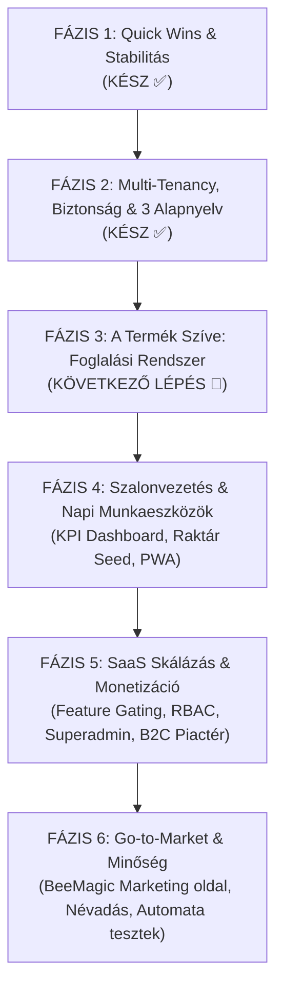
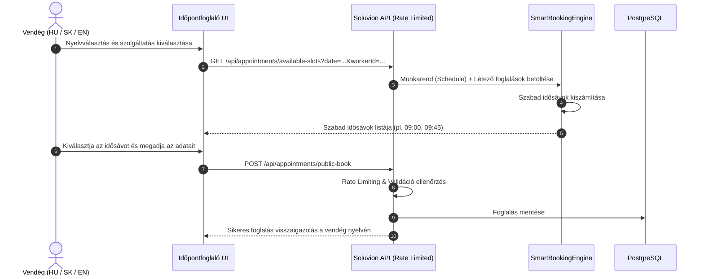

# 05. Master Fejlesztési Ütemterv (Roadmap) & Stratégiai Akcióterv
**Projekt:** Soluvion / BeeMagic SaaS  
**Dátum:** 2026. október 12.  
**Cél:** A 30 azonosított feladat logikai, függőségi és üzleti prioritási sorrendbe szervezése.

---

## 1. Stratégiai Fázisok Áttekintése (Függőségi Gráf)

---

## 2. A 30 Feladat Logikai Fázisai és Prioritásai

### FÁZIS 1: Azonnali Javítások és Gyors Sikerek (Quick Wins) — [KÉSZ ✅]
> [!NOTE]
> **Státusz: Kész, élesítve.** Megszűntek a vizuális kontraszthibák, bevezetésre került a reaktív `authStore` és a `useAutoSaveQueue`, elkészült a központi `GEMINI.md` szabályzat és a frissített dokumentáció.

| # | Eredeti pont | Feladat | Státusz | Érintett komponensek |
|---|---|---|---|---|
| **1.1** | **#18** | **HomeView sötét/világos kontraszthiba javítása** | Kész ✅ | `main.js`, `HomeView.vue`, Tailwind |
| **1.2** | **#19** | **Bejelentkezés finomítása: authStore & Token config** | Kész ✅ | `authStore.js`, `LoginView.vue`, `appsettings.json` |
| **1.3** | **#20** | **ServicesView mentési logika cseréje useAutoSaveQueue-ra** | Kész ✅ | `ServicesView.vue`, `useAutoSaveQueue.js` |
| **1.4** | **#7** | **Új `GEMINI.md` (AI prompt kontextus) létrehozása** | Kész ✅ | Projekt gyökér: `GEMINI.md` |
| **1.5** | **#6** | **Szabálykönyvek frissítése (#01, #02, #03)** | Kész ✅ | `DevDoc/01_*.md`, `02_*.md`, `03_*.md` |

---

### FÁZIS 2: Multi-Tenancy, Biztonság, Validáció és a 3 Alapnyelv (HU, SK, EN) — [KÉSZ ✅]
> [!IMPORTANT]
> **Státusz: Kész, stabilizálva, `develop` ágra beolvasztva.**
> Elkészült a 3 teljes gyári nyelvi csomag (`hu`, `sk`, `en`), megvalósult a tenant nyelvi szuverenitás (be-/kikapcsolás, alapértelmezett nyelv váltás), arculatvédelem (`home.*` brand szövegek védelme), DTO DataAnnotations validáció, `IUserContext`, .NET 10 `GlobalExceptionHandler` és gépi `errorCode` szabvány.

| # | Eredeti pont | Feladat | Státusz | Részletek & Eredmények |
|---|---|---|---|---|
| **2.1** | **#25** | **Multi-Tenant Domain / Subdomain Feloldás** | Kész ✅ | Hostname / Subdomain alapú tenant feloldás a `TenantResolutionMiddleware`-ben. Éles domain védve a manuális `forceTenant` manipuláció ellen. |
| **2.2** | **#14** | **Tenant Isolation (Adatszeparáció)** | Kész ✅ | EF Core globális lekérdezési szűrők (`HasQueryFilter(e => e.CompanyId == currentCompanyId)`), garantált szeparáció szalonok között. |
| **2.3** | **#27** | **Időpont-jogosultságok és `IUserContext`** | Kész ✅ | `IUserContext` bevezetése: ClaimsPrincipal alapú felhasználói és szalon azonosítás a Service és Controller rétegekben. |
| **2.4** | **#26** | **Backend DTO és Üzleti Validáció** | Kész ✅ | .NET natív `System.ComponentModel.DataAnnotations` (`[Required]`, `[Range]`, `[MaxLength]`) a DTO-kban, azonnali `400 ProblemDetails` védelem. |
| **2.5** | **#12, #28** | **Globális hibakezelés & ErrorCode szabvány** | Kész ✅ | .NET 10 `IExceptionHandler` bevezetve. Zéró beégetett magyar hibaüzenet: a backend gépi hibakódokat (`errorCode`) ad vissza, a kliens `$t('errors.' + code)`-dal fordítja. |
| **2.6** | **#30** | **3 Gyári Alapnyelv (HU, SK, EN) & Nyelvi Szuverenitás** | Kész ✅ | 3 teljes natív nyelvi csomag (`hu/`, `sk/`, `en/`). Nyelvek ki-/bekapcsolhatósága (`ToggleSwitch`), alapértelmezett nyelv váltás, 1 nyelv esetén automatikusan rejtett fejléc váltó, arculatvédelem a felülírásoknál, fordításkereső az adminban. |

---

### FÁZIS 3: A Termék Szíve: Komplett Foglalási Rendszer (Booking Engine) — [KÖVETKEZŐ LÉPÉS 🚀]
> [!NOTE]
> Ez az a funkció, amiért a szalonok fizetni fognak. Mivel a Fázis 2-ben a 3 alapnyelv elkészült, a publikus felület azonnal szlovák, magyar és angol nyelven fogadja a vendégeket!

| # | Eredeti pont | Feladat | Leírás |
|---|---|---|---|
| **3.1** | **#22** | **Dolgozók és Heti Munkarend (Schedule) Kezelése** | Dolgozói munkaidők, szünetek, szabadságok nyilvántartása DB-ben és egy könnyen kezelhető admin felületen (pl. Hétfő: 08:00 - 16:00, Kedd: pihenőnap). |
| **3.2** | **#23** | **Okos Időpontválasztó UI & Szabad Idősávok (`GetAvailableSlots`)** | A natív `datetime-local` input teljes kivezetése! A backend kiszámolja a szabad perceket a szolgáltatás időtartama és a munkarend alapján, a vendég pedig tiszta, kattintható időpont-kártyákból választ. |
| **3.3** | **#10** | **Nyilvános berendelés a szalonba (Vendég foglalási flow)** | Reszponzív, 3-nyelvű lépésről-lépésre foglaló felület (Szolgáltatás -> Dolgozó -> Időpont -> Adatok -> Visszaigazolás). |
| **3.4** | **#21** | **Publikus Foglalási Végpont Védelme (Rate Limiting)** | A .NET 10 beépített `AddRateLimiter` middleware-jével IP és Session alapú korlátozás beállítása a spam és naptáreltömítés ellen. |

---

### FÁZIS 4: Szalonvezetés és Napi Munkaeszközök
> A már működő szalonok megtartását és hatékonyságát segítő funkciók.

| # | Eredeti pont | Feladat | Leírás |
|---|---|---|---|
| **4.1** | **#24** | **Dashboard Pénzügyi és Forgalmi KPI Kártyák** | Napi/havi bevétel, vendégszám, kihasználtság megjelenítése a Dashboard tetején. Tulajdonos látja a teljes szalont, dolgozó csak a sajátját. |
| **4.2** | **#4** | **Alap Terméklisták Inicializálása (Seeding)** | Gyakori szalonmárkák (L'Oréal Majirel, Inoa, Dia Light, Mon Platin stb.) előre betöltött katalógusként, hogy az új szalonnak ne kelljen 200 terméket nulláról begépelnie. |
| **4.3** | **#1** | **PWA támogatás beépítése (Progressive Web App)** | `manifest.json`, Service Worker, offline fallback és mobil kezdőképernyőre telepíthető ikon (fodrászoknak mint natív app a zsebükben). |

---

### FÁZIS 5: SaaS Skálázás, Jogosultságok és Monetizáció
> Amikor több szalont szolgálsz ki, és különböző előfizetési csomagokat akarsz értékesíteni.

| # | Eredeti pont | Feladat | Leírás |
|---|---|---|---|
| **5.1** | **#2, #15** | **Entitlement & Feature Gating** | Funkciókapcsolók csomagok szerint (pl. *Starter:* 1 dolgozó, alapszolgáltatások; *Pro:* korlátlan munkatárs, AI szállítólevél szkennelés, raktárkezelés). |
| **5.2** | **#16** | **RBAC / ABAC Jogosultságkezelés** | Szerepkörök szigorítása: `Owner` (mindenhez hozzáfér), `Manager` (naptár + raktár), `Worker` (csak saját naptár és anyagfelhasználás), `Guest`. |
| **5.3** | **#17** | **Superadmin Felület & Impersonation** | Platform szintű adminisztrátori felület (BeeMagic központ), ahol látható az összes regisztrált szalon, és ügyfélszolgálati célból be lehet lépni a nevükben hibaelhárításra. |
| **5.4** | **#5** | **PrimarySegmentID (Iparági Sablonok)** | Lehetővé teszi, hogy ne csak fodrászatok, hanem kozmetikák, körmösök, masszázsszalonok is használhassák a rendszert saját alapértelmezett beállításokkal. |
| **5.5** | **#29** | **B2C Piactér Felkészítés: Globális User fiók** | A `User.CompanyId` lazítása kapcsolótáblára, hogy egy vendég több különböző szalonba is tudjon foglalni ugyanazzal a regisztrációval. |

---

### FÁZIS 6: Go-to-Market, Minőség és Értékesítés
> A szoftver piacra lépése, eladása és hosszú távú stabilitása.

| # | Eredeti pont | Feladat | Leírás |
|---|---|---|---|
| **6.1** | **#8** | **Projekt és Terméknév Véglegesítése** | Új brand kialakítása (pl. *BeeMagic Salon*, *AuraSalon*, *BeeSalon*). |
| **6.2** | **#9** | **Marketing Weboldal Létrehozása (BeeMagic)** | Értékesítési landing page: funkciók bemutatása, demó kérés, árazási csomagok, SaaS regisztrációs tölcsér. |
| **6.3** | **#11** | **Automatizált Tesztelés (Unit & Integrációs tesztek)** | A kritikus üzleti logikák lefedése: naptár ütközésvizsgálat, raktárkészlet-levonás és multi-tenant izoláció automatikus tesztelése. |
| **6.4** | **#3** | **Kódminőség és Refactor záró sprint** | Halott kódok takarítása, dependency frissítések, bundle-size optimalizálás. |

---

## 3. Részletes Koncepció a 30. Feladathoz (i18n & 3 Alapnyelv)

### A Rendszer- és a Szalonszövegek Kettéválasztása:
1. **Gyári Rendszerszövegek (System UI - 100% statikus & ellenőrzött):**
   * Minden menüpont, gombfelirat, naptárcímke, dialógus, táblázatfejléc, beállítás és hibaüzenet bekerül a `src/locales/` könyvtárba 3 nyelven:
     - `src/locales/hu/` (Magyar)
     - `src/locales/sk/` (Szlovák - anyanyelvi, szalonokban megszokott szakmai kifejezésekkel)
     - `src/locales/en/` (Angol - nemzetközi SaaS szabvány)
   * **Előny:** Új szalon regisztrációjakor vagy nyelvváltáskor **nulla AI token és nulla várakozási idő**, azonnal 100%-ban működik a teljes felület mindhárom nyelven.

2. **Dinamikus Szalontartalom (Tenant-specifikus adatok):**
   * Az árlista, szolgáltatásnevek (pl. *„Balayage melír + vágás”*), dolgozók bemutatkozása.
   * Ezeknél minden szalon a saját nyelvén rögzíti az adatokat, és a meglévő háttér-AI fordító segít lefordítani a többi nyelvre, ha a szalon kéri.

3. **Backend Hibakezelés több nyelven:**
   * A backend ne nyers magyar szövegeket adjon vissza (`"Legalább 1 képet fel kell tölteni"`), hanem szabványos **hibakódokat** (pl. `errors.inventory.imageRequired`).
   * A frontend az i18n segítségével a felhasználó által választott nyelven (HU, SK, EN) írja ki a hiba toastot.

